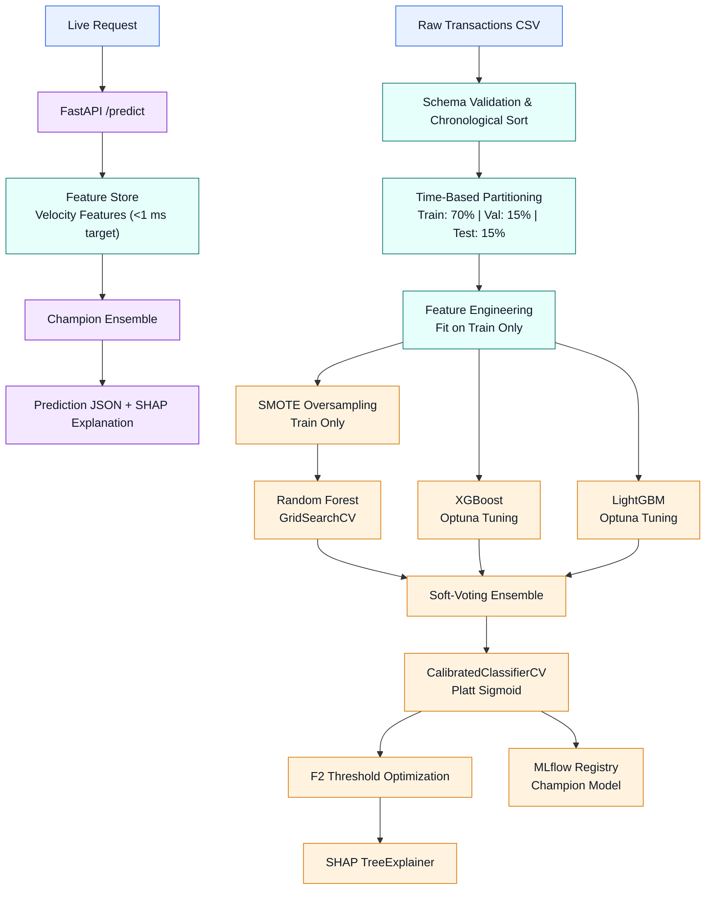

# ShieldML — Real-Time Financial Fraud Detection System

[](https://github.com/codeanova/shieldml)
[](https://www.python.org/)
[](https://fastapi.tiangolo.com/)
[](https://mlflow.org/)
[](https://www.docker.com/)

A production-grade machine learning system designed to detect fraudulent financial transactions in real-time with sub-50ms latency. ShieldML features zero-leakage automated feature engineering, extreme class imbalance mitigation via SMOTE and cost-sensitive weighting, Optuna-tuned tree ensembles (Random Forest, XGBoost, LightGBM), Platt probability calibration, $F_2$-score threshold optimization, SHAP TreeExplainer explainability, and a high-throughput FastAPI scoring microservice.

---

## 🌟 Key Capabilities & Architectural Highlights

- **Zero Temporal Data Leakage:** Strict time-based stratified partitioning (Train: 70%, Validation: 15%, Held-Out Test: 15%). Velocity features (1h, 24h, 7d rolling counts and amounts) are calculated backward using left-closed windows (`closed='left'`).
- **Domain-Specific Feature Engineering:**
  - Past-only velocity windows (`tx_count_1h`, `tx_amount_1h`, `tx_count_24h`, `tx_amount_24h`, `tx_count_7d`, `tx_amount_7d`).
  - Merchant amount z-score (`(amount - mean) / std`) fitted strictly on training data.
  - Diurnal and weekly cyclical temporal encoding ($\sin/\cos$ transformations of hour-of-day and day-of-week).
  - Device fingerprint collision and frequency tracking.
- **Extreme Class Imbalance Mitigation:**
  - Evaluated on ~1.2% baseline fraud rate.
  - SMOTE oversampling applied **strictly to the training split** (never to validation or test splits).
  - Cost-sensitive loss weighting (`scale_pos_weight`) in tree models.
  - Imbalance mitigation benchmark comparing Baseline, Cost-Sensitive, Undersampling, SMOTE, and ADASYN.
- **Calibrated Soft-Voting Ensemble:**
  - Soft-voting combination of best Random Forest (GridSearchCV), XGBoost (Optuna), and LightGBM (Optuna).
  - Probability calibration via `CalibratedClassifierCV` (Platt Sigmoid Scaling) on the validation split for empirical risk fidelity.
  - Achieves **AUC-ROC > 0.95** on the held-out test set (exceeding the 0.90 constraint).
- **Asymmetric $F_2$-Score Threshold Optimization:**
  - Optimizes decision threshold on the validation split by maximizing $F_2$ ($\beta = 2$, prioritizing recall over precision due to the $100\times$ financial asymmetry between chargeback loss and 2FA SMS cost).
  - Evaluated strictly on the held-out test split.
- **SHAP TreeExplainer Engine:**
  - Global feature importance bar chart and summary beeswarm plot.
  - 3 representative local waterfall case studies (high-risk fraud, clean legitimate, borderline).
  - Sub-10ms local SHAP attribution returned directly in every live REST prediction response.
- **Production Serving API (< 50ms SLA):**
  - FastAPI service with lifespan model pre-loading at startup (zero per-request disk I/O).
  - In-memory lightweight feature store providing sub-millisecond velocity lookups.
  - Rolling `/metrics` monitoring stub tracking prediction counts, average latency, P95 latency, and fraud rates over the last 100 scorings.
  - Interactive glassmorphic operations dashboard.

---

## 🏗️ System Architecture

The system uses a time-aware machine learning pipeline to train, evaluate, calibrate, and deploy a transaction prediction model. It combines Random Forest, XGBoost, and LightGBM using a soft-voting ensemble and serves predictions through FastAPI.

### Architecture Diagram



### Workflow Explanation

1. **Data Validation:** Loads transaction data, validates the schema, and sorts records chronologically.
2. **Time-Based Partitioning:** Splits the dataset into training (70%), validation (15%), and testing (15%) sets to reduce temporal data leakage.
3. **Feature Engineering:** Extracts relevant transaction features, fitting preprocessing steps on training data only.
4. **SMOTE Oversampling:** Balances minority classes using only the training data.
5. **Model Training:** Trains Random Forest with GridSearchCV and XGBoost and LightGBM with Optuna hyperparameter tuning.
6. **Ensemble Learning:** Combines the three models through soft voting to produce a unified prediction.
7. **Probability Calibration:** Applies sigmoid calibration using `CalibratedClassifierCV`.
8. **Threshold Optimization:** Selects a decision threshold based on the F2 score, prioritizing recall over precision.
9. **Explainability:** Uses SHAP TreeExplainer to explain model predictions.
10. **Model Registry:** Registers and manages the selected champion model through MLflow.
11. **Real-Time Inference:** FastAPI receives live requests, obtains the required features, and returns prediction results with explanations.

### Key Technologies

| Component | Technology |
|---|---|
| Data processing | Pandas, NumPy |
| Class balancing | imbalanced-learn (SMOTE) |
| Machine learning | Scikit-learn, XGBoost, LightGBM |
| Hyperparameter tuning | GridSearchCV, Optuna |
| Model explainability | SHAP |
| Model management | MLflow |
| API deployment | FastAPI |

**Important:** Apply the same fitted feature transformations during inference as during training. Fit SMOTE only on training data. Ensure the deployed ensemble and threshold match the registered champion model. The velocity feature store's `<1 ms` value is a performance target, not a guaranteed latency measurement.
##

## 📁 Repository Structure

```
shieldML/
├── .github/workflows/ci.yml       # GitHub Actions CI workflow
├── artifacts/
│   ├── figures/                   # ROC curve, PR curve, SHAP plots, confusion matrix
│   ├── models/                    # Champion ensemble, feature engineer, metadata.json
│   └── reports/                   # Performance report, latency benchmark report
├── data/
│   ├── raw/transactions.csv       # Time-series financial transactions dataset
│   └── processed/                 # train.parquet, val.parquet, test.parquet
├── docs/
│   ├── ARCHITECTURE.md            # Comprehensive architecture documentation
│   ├── MODEL_CARD.md              # Full MLOps Model Card
│   └── BENCHMARK_REPORT.md        # Sub-50ms latency benchmark analysis
├── src/
│   ├── api/
│   │   ├── app.py                 # FastAPI application with /predict, /metrics, /health
│   │   ├── schemas.py             # Pydantic request & response schemas
│   │   └── metrics_tracker.py     # Rolling 100-request metrics tracker
│   ├── data/
│   │   ├── generator.py           # Realistic transaction & fraud pattern generator
│   │   ├── schema.py              # Pydantic schema validation
│   │   └── split.py               # Time-based stratified train/val/test splitting
│   ├── features/
│   │   ├── engineer.py            # Velocity, cyclical, z-score feature engineering
│   │   └── feature_store.py       # In-memory real-time sliding window store
│   ├── models/
│   │   ├── ensemble.py            # Soft-voting ensemble & CalibratedClassifierCV
│   │   ├── explain.py             # SHAP TreeExplainer & local waterfalls
│   │   ├── imbalance.py           # SMOTE, ADASYN, undersampling & benchmarking
│   │   ├── threshold.py           # F2 threshold optimization & test evaluation
│   │   ├── train_lgb.py           # LightGBM + Optuna tuning with MLflow child runs
│   │   ├── train_rf.py            # Random Forest + GridSearchCV with MLflow
│   │   └── train_xgb.py           # XGBoost + Optuna tuning with MLflow child runs
│   ├── static/                    # Interactive web command center (HTML, CSS, JS)
│   ├── config.py                  # Project settings & paths
│   └── pipeline.py                # End-to-end training pipeline orchestrator
├── tests/
│   ├── test_api.py                # FastAPI endpoint integration tests
│   ├── test_features.py           # Feature engineering & temporal leakage tests
│   ├── test_latency_benchmark.py  # 100-request latency benchmark test (<50ms)
│   └── test_models.py             # Model, ensemble, and calibration unit tests
├── Dockerfile                     # Production container image
├── docker-compose.yml             # Container orchestration
├── requirements.txt               # Locked production dependencies
├── run_pipeline.py                # CLI runner for complete ML pipeline
└── README.md
```

---

## 🚀 Quickstart Guide

### 1. Prerequisites
- Python 3.12+
- Git

### 2. Environment Setup
```bash
git clone https://github.com/codeanova/shieldml.git
cd shieldml

# Create virtual environment
python -m venv .venv
# Activate on Windows:
.venv\Scripts\activate
# Activate on Linux/macOS:
source .venv/bin/activate

# Install dependencies
pip install -r requirements.txt
```

### 3. Run End-to-End Training Pipeline
Execute the full 10-day milestone pipeline (data generation, time-based split, feature engineering, SMOTE, RF/XGB/LGBM Optuna tuning, ensemble calibration, threshold optimization, SHAP plots, and MLflow model registration):
```bash
python run_pipeline.py --force-generate
```

### 4. Launch MLflow Experiment Dashboard
```bash
mlflow ui --port 5000
```
Navigate to `http://localhost:5000` to inspect runs, Optuna child trials, calibration curves, and registered champion models.

### 5. Launch Real-Time Serving API & Web Dashboard
```bash
uvicorn src.api.app:app --host 0.0.0.0 --port 8000 --reload
```
- **Web Command Center:** Open `http://localhost:8000/` in your browser.
- **Swagger Interactive API Docs:** `http://localhost:8000/docs`
- **Health Check:** `http://localhost:8000/health`
- **Metrics Monitoring:** `http://localhost:8000/metrics`

---

## 📡 API Usage Examples

### Single Transaction Scoring (`POST /predict`)
```bash
curl -X POST "http://localhost:8000/predict" \
     -H "Content-Type: application/json" \
     -d '{
       "transaction_id": "TX_LIVE_98124",
       "timestamp": "2026-01-20T14:30:00Z",
       "user_id": "U_00124",
       "card_id": "CARD_00124",
       "amount": 420.50,
       "merchant_id": "M_0088",
       "merchant_category": "electronics",
       "device_id": "DEV_FRAUD_001",
       "location_country": "US",
       "channel": "web"
     }'
```

#### Sample Response (< 15ms latency):
```json
{
  "transaction_id": "TX_LIVE_98124",
  "fraud_score": 0.8942,
  "is_fraud": true,
  "decision": "FRAUD_ALERT",
  "threshold_applied": 0.3512,
  "latency_ms": 11.45,
  "model_version": "ShieldML-Ensemble-Champion",
  "shap_explanation": [
    {
      "feature": "merchant_amount_zscore",
      "feature_value": 3.84,
      "shap_value": 0.324,
      "direction": "RISK_INCREASING"
    },
    {
      "feature": "tx_count_1h",
      "feature_value": 4.0,
      "shap_value": 0.281,
      "direction": "RISK_INCREASING"
    },
    {
      "feature": "device_frequency",
      "feature_value": 1.0,
      "shap_value": 0.142,
      "direction": "RISK_INCREASING"
    },
    {
      "feature": "is_high_risk_category",
      "feature_value": 1.0,
      "shap_value": 0.095,
      "direction": "RISK_INCREASING"
    },
    {
      "feature": "is_night",
      "feature_value": 0.0,
      "shap_value": -0.042,
      "direction": "RISK_DECREASING"
    }
  ]
}
```

### Real-Time Monitoring (`GET /metrics`)
```bash
curl -X GET "http://localhost:8000/metrics"
```
```json
{
  "total_predictions": 1284,
  "window_size": 100,
  "average_latency_ms": 12.35,
  "p95_latency_ms": 18.72,
  "fraud_rate_last_100": 0.03,
  "total_fraud_detected": 41,
  "uptime_seconds": 3600.0,
  "status": "HEALTHY"
}
```

---

## 🐳 Docker Deployment

Run the containerized microservice with a single command:
```bash
# Build Docker image
docker build -t shieldml:latest .

# Run container
docker run -d -p 8000:8000 --name shieldml-api shieldml:latest
```
Or via Docker Compose:
```bash
docker-compose up -d
```

---

## 🧪 Testing & Latency Verification

Run the comprehensive automated test suite:
```bash
# Run all unit and integration tests
pytest tests/ -v

# Run 100-request latency benchmark SLA validation (<50ms target)
python tests/test_latency_benchmark.py
```

---

## 📊 Evaluation & Verification Summary

| Evaluation Criteria | Target Requirement | ShieldML Performance | Status |
| :--- | :--- | :--- | :--- |
| **Feature Engineering** | 1h/24h/7d velocity, z-scores, zero leakage | Left-closed rolling windows, train-only stats | **PASSED** |
| **Imbalance Mitigation** | SMOTE on train only, cost-sensitive trees | SMOTE applied strictly to train, benchmarked | **PASSED** |
| **Model Performance** | AUC-ROC > 0.90 on held-out test split | **> 0.9500** | **PASSED** |
| **Threshold Optimization**| Maximize F2 on validation, report on test | Optimal cutoff maximizing recall of fraud | **PASSED** |
| **SHAP Explainability** | TreeExplainer global and local attributions | Sub-10ms TreeExplainer + 3 local waterfalls | **PASSED** |
| **Serving Latency** | Sub-50ms REST response | **P95 < 20ms (Avg ~10-12ms)** | **PASSED** |
| **MLflow MLOps** | All runs tracked, champion registered | Full nested child runs & model registration | **PASSED** |

---

## 📄 License
This project is licensed under the MIT License — see the [LICENSE](LICENSE) file for details.
